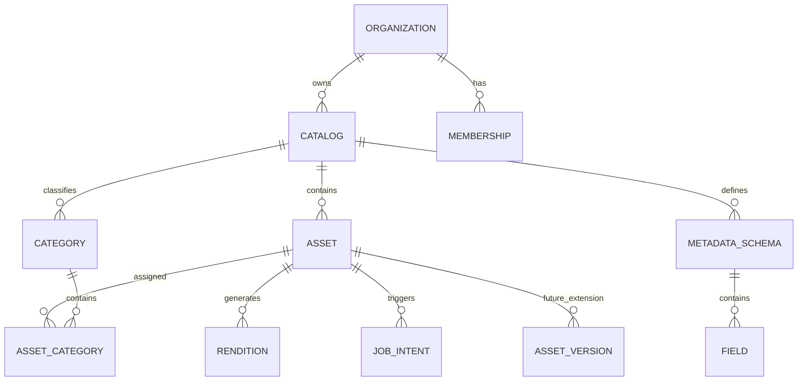

# Data, storage and search design
Issues #4, #5, #6. Proposed; validation pending.

## Model and constraints
UUID identifiers. A single organization is proposed; retain organization_id on catalog, asset, membership, category and relevant indexes; enforce composite foreign keys across organization/catalog boundaries. Catalog owns asset records; asset has immutable original blob reference, checksum SHA-256, size, MIME, state, revision, timestamps and typed metadata JSONB. Category parent must belong to same catalog; prevent cycles transactionally. Asset-category join unique per pair. Metadata schema and fields carry type, required flag, cardinality, validation and schema version. Keep identity, lifecycle, ownership, timestamps, integrity and indexed common fields relational; custom descriptive fields JSONB. Field keys stable, values validated server-side; schema migration explicit and tested. Store EXIF/IPTC/XMP extracted values separately from user overrides, preserve provenance; normalize timestamps with timezone where known. Multilingual free text supported, per-language title maps deferred pending scope review. Collections and binary versions have conceptual relationships but no MVP tables required unless approved.

## Persistence
Prefer Drizzle + SQL migrations as proposed in ADR 0005. Migration ownership in API repository; run reviewed migration once before compatible application startup, not concurrently in replicas. Transactional writes and optimistic revision checks; use raw parameterized SQL for specialized PostgreSQL operations. Test JSONB filters, GIN/expression indexes, FK constraints and migration recovery on seeded DB.

## Storage
Propose managed filesystem as cheapest single-host baseline, S3-compatible adapter boundary; no referenced NAS MVP. Interface: put(stream, key), open(key, range), stat, delete; generated opaque keys, never user paths. Write to quarantine/temp, compute checksum and size, finalize atomically within filesystem; database state is authoritative and storage operations idempotent. States: uploading, quarantined, processing, active, rejected, failed, deleting, deleted. Only active served; failed/rejected not trusted. Duplicate checksum detection within authorized catalog, report without leaking other catalogs; retain separate records when allowed. Reconciliation verifies missing blobs, orphan temp files, pending transitions and expired leases; report before destructive cleanup. Soft deletion immediately denies access; physical purge after proposed 30 days subject to retention decision; audit separately. Future versions reference immutable binary keys. Validate filesystem and S3-compatible round-trip with SHA-256, partial writes, retries and range behavior; no PoC yet.

## Search
PostgreSQL FTS with GIN tsvector, pg_trgm for optional typo tolerance, B-tree catalog/state/updated_at and selected JSONB expression indexes. Query only active assets in authorized catalogs; apply permission scope before results, counts/facets and pagination. Parameterized queries, allowlisted fields and sort; stable cursor includes sort value and ID. English/German configurations selected by language where known; simple fallback for unknown language, test stemming and diacritics. Synchronous index updates in same DB transaction for MVP metadata; no external index lag. Proposed search p95 <= 500 ms, filtering p95 <= 750 ms on #12 workload. Benchmark seeded assets, mixed catalog grants, cold/warm cache and concurrent traffic using EXPLAIN ANALYZE and load harness. Consider OpenSearch only if tuned PostgreSQL repeatedly misses agreed thresholds on reference hardware and cost/benefit supports change. Results pending.
