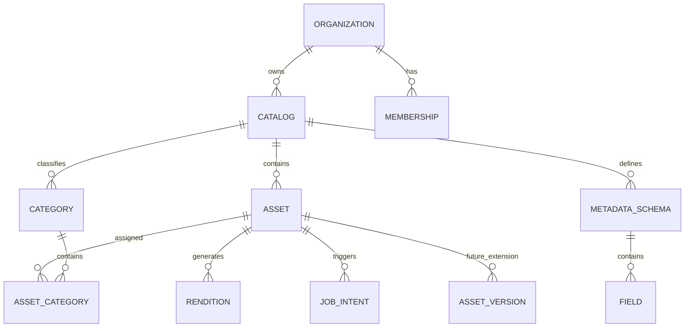

# Data, storage and search design
Issues #4, #5, #6. Proposed; validation pending.

## Model and constraints
UUID identifiers. A single organization is proposed; retain organization_id on catalog, asset, membership, category and relevant indexes, and enforce composite foreign keys across organization/catalog boundaries.

- **Assets:** a catalog owns asset records. An asset has an immutable original blob reference, SHA-256 checksum, size, MIME type, state, revision, timestamps and typed metadata JSONB.
- **Categories:** a parent must belong to the same catalog; prevent cycles transactionally. Asset-category pairs are unique.
- **Metadata schema:** fields carry type, required flag, cardinality, validation and schema version. Identity, lifecycle, ownership, timestamps, integrity and indexed common fields are relational; custom descriptive fields are JSONB. Field keys are stable, values validated server-side, schema migrations explicit and tested.
- **Embedded metadata:** store extracted EXIF/IPTC/XMP values separately from user overrides and preserve provenance; normalize timestamps with timezone where known.
- **Deferred:** multilingual free text is supported; per-language title maps await scope review. Collections and binary versions are conceptual only, with no MVP tables unless approved.

## Persistence
Use EF Core with the Npgsql provider as proposed in [ADR 0005](../adr/0005-persistence.md). Migrations live in the infrastructure project, are reviewed as SQL, and ship as a migration bundle that runs once before compatible application startup, never concurrently in replicas. Writes are transactional with optimistic concurrency on the revision column; use raw parameterized SQL for specialized PostgreSQL operations. Test JSONB filters, GIN/expression indexes, foreign-key constraints and migration recovery on a seeded database.

## Storage
Managed filesystem is proposed as the cheapest single-host baseline, behind an S3-compatible adapter boundary; no referenced NAS in the MVP.

- **Interface:** put(stream, key), open(key, range), stat, delete. Keys are generated and opaque, never user paths.
- **Writes:** write to quarantine/temp, compute checksum and size, finalize atomically within the filesystem. Database state is authoritative and storage operations are idempotent.
- **States:** uploading, quarantined, processing, active, rejected, failed, deleting, deleted. Only active assets are served; failed/rejected are never trusted.
- **Duplicates:** checksum detection within an authorized catalog, reported without leaking other catalogs; separate records are kept when allowed.

Reconciliation verifies missing blobs, orphan temp files, pending transitions and expired leases, and reports before any destructive cleanup. Soft deletion immediately denies access; physical purge follows after the retention period and is audited separately (see Deletion and purge below). Future versions reference immutable binary keys. Validate filesystem and S3-compatible round trips with SHA-256, partial writes, retries and range behavior; no PoC yet.

### Deletion and purge
- **Soft delete:** an editor's delete moves the asset to `deleting`. Every read route (details, content with Range and HEAD, renditions, search results and counts, category lists) treats it as not found at once, and writes to it return 404. Blobs are kept.
- **Downloads in progress:** a response that started before the soft delete may finish, because blobs are only removed by the purge. Any new request, including the next Range request of a resumed download, gets 404.
- **Retention:** `Retention:SoftDeletedAssets` (for example `Retention__SoftDeletedAssets=30.00:00:00`) sets how long soft-deleted assets are kept. It has no default: 30 days is a proposal until the retention policy is approved, and while it is unset the worker logs that the purge is disabled and removes nothing.
- **Purge:** the worker runs hourly (`Retention:PurgeInterval`) and handles at most `Retention:PurgeBatchSize` assets (default 100), oldest first. For each asset soft-deleted before the cutoff it deletes the rendition blobs and the original (a missing blob counts as deleted), then in one transaction re-checks the asset under a row lock, removes rendition rows and category links, marks it `deleted` and records `asset.purge` (actor `system:retention`). The row stays for audit.
- **Failures:** if a blob cannot be deleted, the asset stays `deleting`, still unreachable, and is retried at the next run; the worker logs a warning per asset. A crash between blob deletion and the database update is repaired the same way. Reconciliation no longer reports `deleting` assets as stale.

## Search
- **Indexes:** PostgreSQL FTS with GIN tsvector, pg_trgm for optional typo tolerance, B-tree on catalog/state/updated_at, and selected JSONB expression indexes.
- **Permissions:** query only active assets in authorized catalogs, and apply the permission scope before results, counts/facets and pagination.
- **Safety:** parameterized queries, allowlisted fields and sort; a stable cursor includes the sort value and ID. Once a catalog has a metadata schema, metadata filters may only name its fields.
- **Facets:** `GET …/assets/facets` returns the total and per-category counts for the same filters, with the same scope as the result list.
- **Language:** English/German configurations selected by language where known, with a simple fallback; test stemming and diacritics.
- **Consistency:** index updates happen synchronously in the same transaction for MVP metadata, so there is no external index lag.

Proposed targets: search p95 ≤ 500 ms and filtering p95 ≤ 750 ms on the #12 workload. Benchmark seeded assets, mixed catalog grants, cold/warm cache and concurrent traffic using EXPLAIN ANALYZE and a load harness. Consider OpenSearch only if tuned PostgreSQL repeatedly misses the agreed thresholds on reference hardware and cost/benefit supports the change.

**Results (2026-11-27):** keyword p95 170 ms and filter p95 35 ms through the API with 10 concurrent users on the 100k-asset workload, 0 unexpected responses, and the ungranted catalog never reachable. Plans, language tests and the migration thresholds are in [search-benchmark.md](search-benchmark.md). The `search-benchmark` workflow re-checks Q1 nightly.
